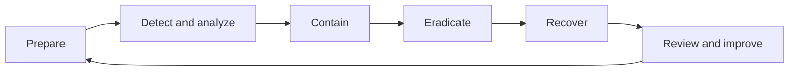

# Incident Response Planning & Security Playbooks

**Project type:** Cybersecurity training — incident response plan and playbook design  
**Scenario:** Capybara Unlimited (training organization)  
**Focus:** Incident readiness, escalation, containment, recovery, communication, and post-incident improvement

## Project overview

I developed a structured **incident response plan (IRP)** for a medium-sized organization as part of my cybersecurity analyst training. The plan describes how a security team would prepare for, detect, assess, contain, eradicate, recover from, and learn from cybersecurity incidents. It also establishes response roles, stakeholder communications, performance measures, and three scenario-specific playbooks.

**Scope clarification:** This is a **planning and documentation exercise**, not evidence that I ran an incident response team, responded to a real organizational breach, deployed the named tools, or tested the procedures in production.

## Objectives and coverage

The training plan set four objectives: **minimize impact**, **restore operations safely**, **strengthen security after incidents**, and **meet applicable reporting and regulatory obligations**. Its intended coverage includes employees and contractors, on-premises and cloud systems, endpoints, networks, and remote access. Addressed incident types include malware/ransomware, phishing, account compromise, data breaches, insider threats, and DoS/DDoS.

## My deliverables

| Deliverable | What it covers |
| --- | --- |
| [Response lifecycle](docs/response-lifecycle.md) | Preparation; detection and analysis; containment; eradication; recovery; post-incident analysis |
| [Roles and communication](docs/roles-and-communications.md) | Incident Commander, SOC, forensic specialists, IT, Legal, communications, and staff |
| [Malware infection playbook](playbooks/malware-infection.md) | Evidence collection, analysis, containment, eradication, recovery, and lessons learned |
| [Phishing response playbook](playbooks/phishing-response.md) | Message investigation, containment, affected-user checks, credential response, and monitoring |
| [Denial-of-service playbook](playbooks/denial-of-service.md) | Attack characterization, impact assessment, affected services, and traffic mitigations |
| [KPIs and maintenance](docs/kpis-and-maintenance.md) | Proposed detection, containment, recovery, closure, and improvement metrics |

## Illustrative incident response flow

## Key design decisions

- **Define accountability:** An Incident Commander coordinates decisions while SOC analysts, investigators, system administrators, Legal, and Communications have distinct responsibilities.
- **Use evidence-led triage:** Incorporate SIEM, endpoint, and network evidence to classify incidents by severity and type before deciding escalation and scope.
- **Preserve forensic material:** Maintain records and protect relevant logs and artifacts throughout analysis and containment.
- **Recover safely:** Validate backups and the absence of residual threats before returning affected systems to service.
- **Communicate deliberately:** Maintain an internal communication log and route regulatory and public notifications through appropriate review.
- **Measure and improve:** Propose metrics for detection, containment, recovery, incident closure, and completion of lessons-learned actions.

## Example technologies mentioned in the plan

The source document lists **Splunk, QRadar, Suricata, Snort, endpoint detection and response products, network firewalls, backup/restore systems, Wireshark, and forensic tools** as possible technology categories or examples. **Listing a product does not claim I deployed or used it in this particular planning exercise.**

## Skills demonstrated

- Incident response process design and documentation
- Security alert classification and escalation planning
- Defensive prioritization and coordination across teams
- Incident-specific procedural playbook writing
- Stakeholder communication and reporting considerations
- Post-incident improvement and operational KPI definition

## Source and limitations

This project is an **original public-facing summary** of my Capybara Unlimited incident response planning assignment from TripleTen cybersecurity training. The original plan is a proposed procedure. It does **not** include evidence of a tabletop exercise, real incident execution, implemented controls, or actual KPI results. Those activities are not claimed here.

Original course templates and unreviewed training materials are not included. No confidential source reports, sensitive datasets, or credentials are published here.
